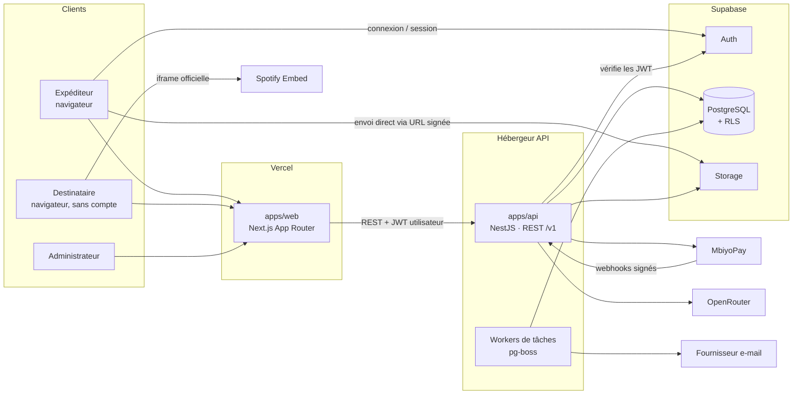
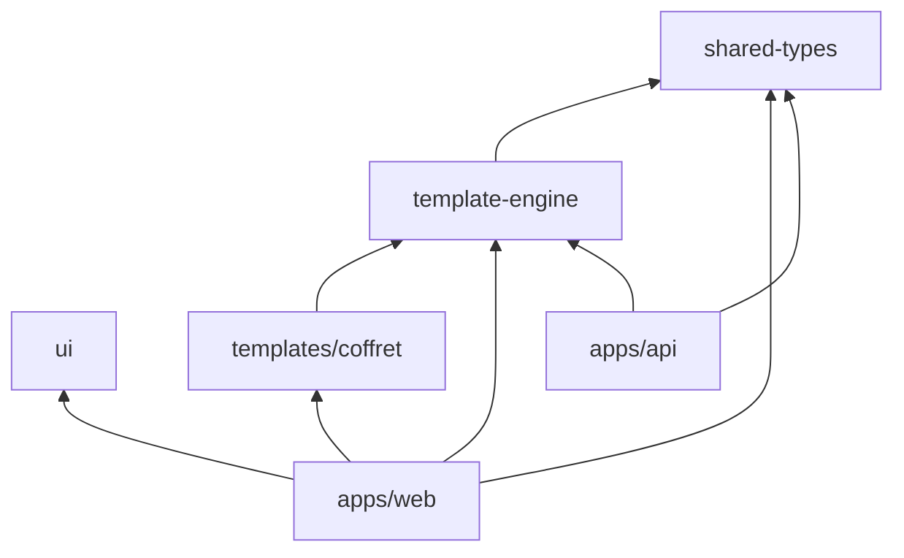
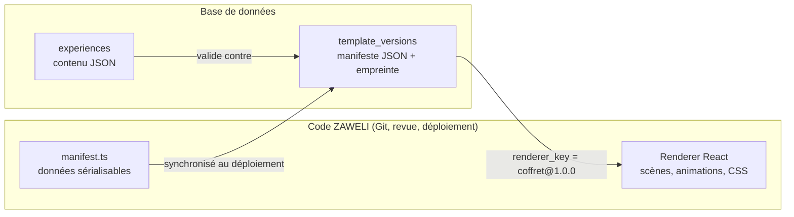
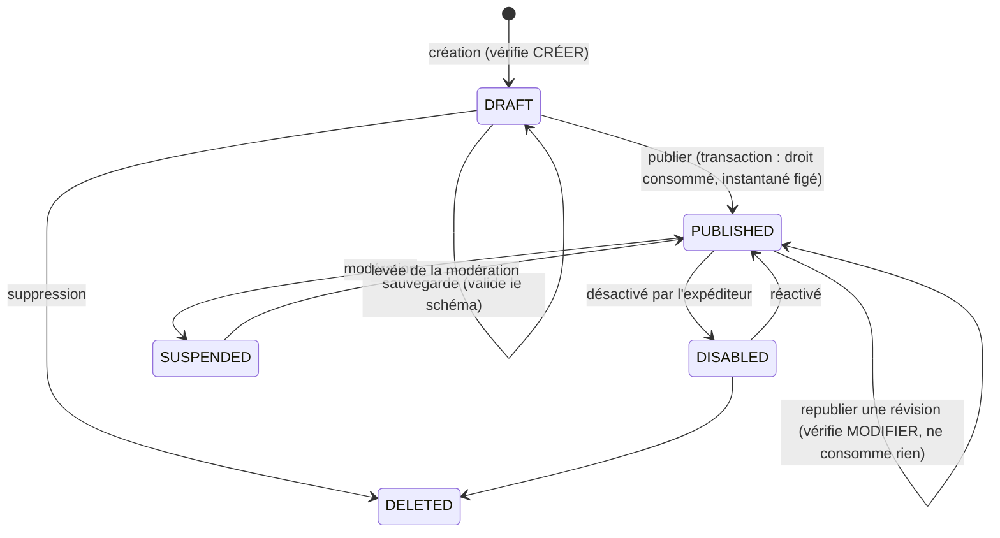
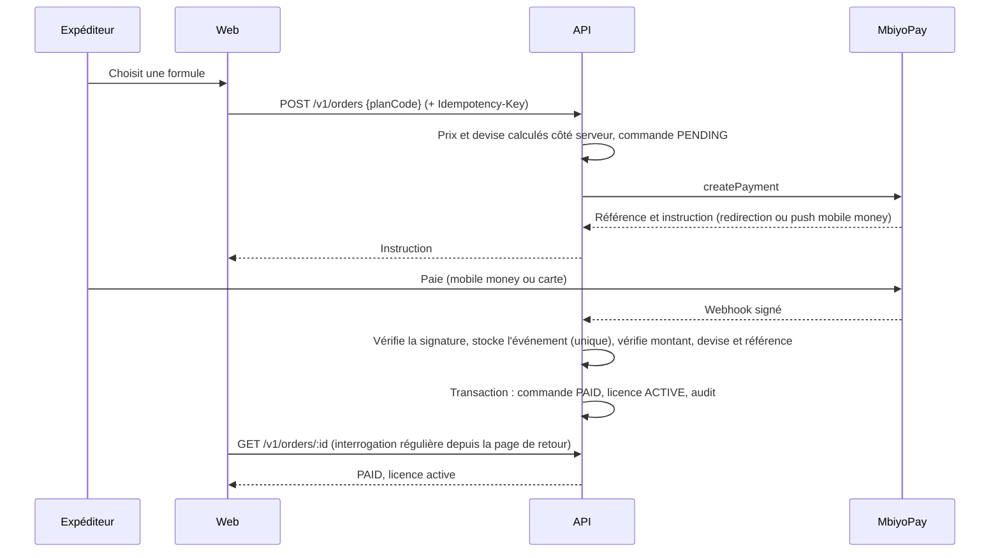
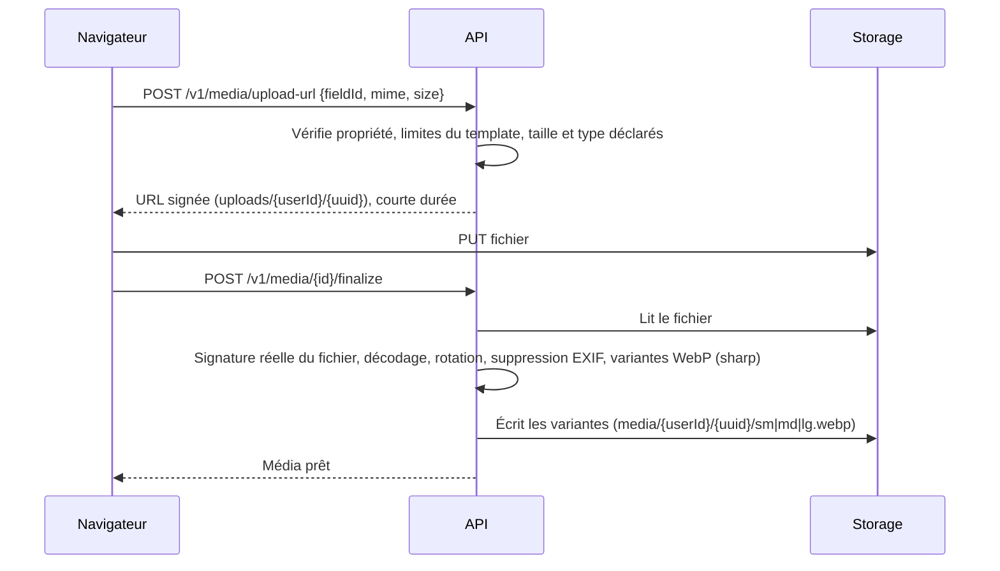

# ZAWELI — Phase 2 : architecture technique

> Statut : **brouillon v0.1, à valider**.
> Date : 6 novembre 2026.
> Entrées : [01-audit-pauline.md](01-audit-pauline.md) et [02-cahier-des-charges.md](02-cahier-des-charges.md) (v0.2, avec C1, C2 et C7 décidés).
>
> Chaque choix structurant est numéroté **A1, A2…** et récapitulé au §15 pour validation.
> Rien n'est encore installé : ce document décrit **ce qui sera construit en phase 5**.

---

## 1. Vue d'ensemble



**Principe directeur** : le navigateur parle à Supabase **uniquement pour l'authentification et l'envoi direct de fichiers via des URLs signées émises par l'API**.
**Toute lecture ou écriture de données métier passe par l'API NestJS**, qui porte toutes les règles : licences, quotas, propriété et paiements.

---

## 2. Monorepo

### 2.1 Outillage — A1

| Choix | Justification |
| --- | --- |
| **pnpm workspaces** | Installation rapide, dépendances strictes (pas d'accès accidentel à un paquet non déclaré). pnpm 9.12 est déjà installé sur ton poste. |
| **Turborepo** | Orchestration des tâches (`build`, `lint`, `test`, `typecheck`) avec cache et dépendances entre paquets. Simple, sans magie. |
| **TypeScript strict** partout | Le moteur de templates et les règles de licence sont trop critiques pour du JavaScript non typé |
| **Node 22 LTS ou plus** | Node 24 est installé localement. La version cible sera fixée dans `.nvmrc` et `engines`. |

Écarté : **Nx**, plus puissant mais plus lourd à apprendre. Turborepo suffit pour 2 applications et une poignée de paquets.

### 2.2 Structure — A2 (ajustements de la structure proposée)

```text
zaweli/
├── apps/
│   ├── web/                    Next.js : public, auth, dashboard, création, admin, /g et /preview
│   └── api/                    NestJS : REST /v1, webhooks, workers
├── packages/
│   ├── shared-types/           Énumérations métier et contrats d'API (schémas Zod partagés)
│   ├── template-engine/        Manifeste, DSL des champs, runner, runtime, types de cadeaux, effets
│   ├── ui/                     Design system du SaaS (pas des templates)
│   └── config/                 ➕ tsconfig, ESLint et Prettier partagés
├── templates/                  ➕ Un paquet par template
│   └── coffret/                Premier template (issu de Pauline)
├── supabase/
│   ├── migrations/             SQL ordonné : source de vérité du schéma
│   ├── seed/                   Données de développement (catalogue, formules)
│   └── config.toml
├── docs/
├── references/                 (si D2 est validé) archive Pauline intacte
├── turbo.json
├── pnpm-workspace.yaml
├── package.json
└── README.md
```

**Ajustements par rapport à ta proposition, et pourquoi :**

1. **`templates/` séparé de `packages/template-engine`.** Le moteur est générique. Chaque template est un paquet indépendant (son code, ses styles, ses polices, ses versions) qui **dépend** du moteur. On ajoute un template sans toucher au moteur, et on peut tester chaque template isolément.
2. **`packages/config`**, pour éviter de dupliquer les réglages TypeScript et ESLint dans 7 paquets.
3. **Le reste est conservé tel quel.**

### 2.3 Dépendances entre paquets



**Règle stricte** : `apps/api` importe **les manifestes et schémas** du moteur pour valider le contenu côté serveur, **jamais les composants React**.
Le moteur expose donc deux points d'entrée :
- `@zaweli/template-engine/schema` : pur TypeScript et Zod, sans React. Utilisé par l'API et le web.
- `@zaweli/template-engine/react` : runner, runtime et effets. Utilisé uniquement par le web.

Les templates suivent le même découpage : `@zaweli/template-coffret/manifest` d'un côté, `@zaweli/template-coffret/renderer` de l'autre.

---

## 3. Application web (`apps/web`, Next.js)

### 3.1 Version — A3

**Next.js App Router, en TypeScript.** La version exacte sera la **dernière version stable au moment de la phase 5**. Son changelog sera vérifié à ce moment-là : je ne fige pas de numéro ici.
**Pas d'export statique**, contrairement au site de Fifi : le tableau de bord, l'authentification et `/g/[slug]` exigent un rendu serveur.

### 3.2 Les quatre zones de l'application

| Zone | Groupe de routes | Rendu | Design |
| --- | --- | --- | --- |
| Site public | `(marketing)/` | Statique et ISR | Design system ZAWELI |
| Authentification | `(auth)/` | Dynamique | Design system ZAWELI |
| Tableau de bord et création | `dashboard/`, `create/` | Dynamique, protégé | Design system ZAWELI |
| Administration | `admin/` | Dynamique, protégé (rôle) | Design system ZAWELI, mode « outil » |
| **Expériences** | `g/[slug]`, `preview/[draftId]` | Dynamique et cache, **sans chrome SaaS** | **Celui du template** |

### 3.3 Routes

```text
(marketing)/
  page.tsx                          Accueil
  templates/page.tsx                Catalogue (+ ?category=)
  templates/[slug]/page.tsx         Détail d'un template
  templates/[slug]/demo/page.tsx    Démonstration (contenu de démo sous licence)
  pricing/  how-it-works/  faq/  contact/  legal/terms/  legal/privacy/
(auth)/
  login/  signup/  forgot-password/  reset-password/  verify/
dashboard/
  page.tsx                          Vue d'ensemble
  experiences/  drafts/  recipients/  licenses/  purchases/  ai/  settings/
  gifts/                            Suivi des cadeaux annoncés
create/
  [templateSlug]/page.tsx           Démarrage : vérification d'éligibilité, choix du destinataire
  [templateSlug]/[draftId]/[step]/  Assistant guidé (une URL par étape)
  [templateSlug]/[draftId]/review/  Vérification, choix de licence, publication
checkout/
  [orderId]/                        Paiement, puis page de retour qui interroge l'API
admin/
  templates/  plans/  users/  licenses/  payments/  reports/  stats/
g/[slug]/                           Expérience publiée (destinataire)
preview/[draftId]/                  Aperçu (propriétaire seulement), rendu dans une iframe
```

**Pas de route `/editor`** : la création est un **assistant en étapes** dont les étapes sont déclarées par le manifeste du template.

### 3.4 L'aperçu est isolé dans une iframe — A4

Dans l'assistant, l'aperçu charge `/preview/[draftId]` **dans une iframe**. C'est la réponse au point R6 de l'audit, et ce choix a trois avantages :

1. **Isolation CSS** : les styles et polices du template (velours, Italiana…) ne fuient pas dans le tableau de bord, et inversement.
2. **Isolation des singletons** (Lenis, confettis, bus audio) : ils vivent dans leur propre document et sont détruits avec l'iframe.
3. **Fidélité** : l'aperçu est **exactement** le rendu public, avec la même route de rendu et la même version de template.

Le passage mobile / ordinateur dans l'aperçu se fait simplement en changeant la largeur de l'iframe.

### 3.5 Styles des templates

- Le SaaS utilise Tailwind et `packages/ui`.
- Chaque template embarque **sa propre feuille de styles**, importée uniquement par le layout de `g/` et `preview/`. Elle est encapsulée sous un attribut racine (`[data-template="coffret"]`) pour limiter les collisions.
- Les polices du template sont chargées par le template lui-même, via Fontsource comme dans Pauline, et seulement sur ces routes.

### 3.6 Session côté web

- `@supabase/ssr` gère la session dans des cookies HttpOnly, côté serveur Next comme côté client.
- Chaque appel à l'API transmet le **jeton d'accès Supabase** (`Authorization: Bearer`).
  Les composants serveur appellent l'API depuis le serveur Next. Les composants client l'appellent directement : l'API autorise les origines via CORS.
- Le web utilise **uniquement la clé publique (anon)** de Supabase, jamais `service_role`.

---

## 4. API (`apps/api`, NestJS)

### 4.1 Principes

- REST **versionné par l'URI** : `/v1/...`, avec la documentation OpenAPI générée par `@nestjs/swagger`.
- **Une erreur = un format unique** : `{ error: { code, message, details? } }`, avec des codes métier stables (par exemple `LICENSE_RECIPIENT_LIMIT_REACHED`), traduits côté web.
- Journalisation structurée en JSON (pino), avec un identifiant de requête propagé.
- Configuration **validée au démarrage** : l'API refuse de démarrer s'il manque un secret.

### 4.2 Validation et DTO — A5

Deux natures de données coexistent :

| Donnée | Exemple | Validation |
| --- | --- | --- |
| **Enveloppes d'API** (forme fixe) | Créer une commande, publier, renommer un destinataire | **DTO** générés depuis des schémas Zod partagés (`nestjs-zod`) : une seule source de vérité pour l'API et le formulaire web. Alternative si ce paquet ne convient pas en phase 5 : `class-validator`, avec les schémas dupliqués côté web. |
| **Contenu d'une expérience** (forme dynamique, dépend du template) | Textes, photos, énigmes, cadeaux de Coffret 1.0.0 | **Schéma Zod compilé à partir du manifeste de la version de template**, exécuté côté serveur à chaque sauvegarde et avant publication |

Un DTO de classe ne peut pas exprimer un schéma qui dépend du template choisi : d'où ce double mécanisme.

### 4.3 Modules

| Module | Responsabilité | Points clés |
| --- | --- | --- |
| `auth` | Garde globale : vérifie le JWT Supabase et extrait `userId` | Vérification par JWKS (clés asymétriques Supabase). Mécanisme exact à confirmer en phase 5. |
| `users` / `profiles` | Profil, préférences, suppression du compte | |
| `roles` | Rôles applicatifs (`admin`, `support`) stockés **en base**, garde `@Roles()` | Pas de confiance dans un rôle envoyé par le client |
| `catalog` | Templates, catégories, versions, manifestes | Lecture publique, écriture admin |
| `recipients` | Fiches destinataires | Propriété stricte |
| `experiences` | Brouillons, contenu, révisions, publication, désactivation | Valide le contenu contre le manifeste. La publication est **transactionnelle**. |
| `media` | URLs d'envoi signées, finalisation, variantes | Contrôle de la signature des fichiers, `sharp`, suppression des EXIF |
| `gifts` | Types de cadeaux, statuts, révélation protégée | Machine à états des statuts |
| `riddles` | Validation **serveur** des énigmes qui protègent une valeur | Tentatives limitées |
| `music` | Bibliothèque de pistes sous licence, validation des liens Spotify | |
| `licensing` | Formules, licences, droits, consommation, liaisons de destinataires | **Cœur des règles commerciales** |
| `orders` | Commandes, prix calculé côté serveur | |
| `payments` | Abstraction `PaymentProvider` et adaptateur MbiyoPay | |
| `webhooks` | Réception et vérification, stockage idempotent, déclenchement des traitements | Corps brut conservé pour la signature |
| `ai` | Abstraction `AiProvider`, adaptateur OpenRouter, quotas, prompts versionnés | |
| `notifications` | E-mails transactionnels via une file de tâches | Fournisseur à choisir (A12) |
| `moderation` | Signalements, désactivation | |
| `admin` | Points d'accès d'administration (sous `/v1/admin`) | Rôle `admin` exigé |
| `audit` | Journal en ajout seul | Appelé par les autres modules |
| `jobs` | Workers pg-boss : médias, e-mails, rapprochement des paiements, expirations | |
| `health` | `/v1/health` (base, stockage) | |

### 4.4 Couches dans chaque module

`controller` (HTTP, DTO) → `service` (règles métier) → `repository` (SQL).
Les règles critiques (licences, publication, paiements) sont des **services purs testables**, avec des tests unitaires exhaustifs sur les scénarios S1 à S19 du cahier des charges.

### 4.5 Accès à la base — A6

| Choix | Justification |
| --- | --- |
| **Migrations SQL Supabase** (`supabase/migrations`) comme **source de vérité** | Les RLS, fonctions SQL, index partiels et contraintes s'expriment naturellement en SQL. Elles sont ordonnées, reproductibles et rejouables avec la CLI Supabase. |
| **Kysely** (constructeur de requêtes typé) dans l'API | Requêtes typées sans ORM « magique ». Transactions et `SELECT … FOR UPDATE` explicites. |
| Types générés depuis la base (`kysely-codegen` ou `supabase gen types`) | Le code et le schéma ne divergent pas |
| Connexion directe à Postgres via le pooler Supabase, avec un **rôle dédié à l'API** | Transactions longues et verrous possibles, ce que l'API REST de Supabase (PostgREST) ne permet pas |

Écartés :
- **Prisma** : son propre système de migrations entre en concurrence avec les migrations Supabase, et il est moins à l'aise avec les RLS et les index partiels.
- **Drizzle** : il est valable, mais il propose lui aussi son propre schéma TypeScript comme source de vérité.

### 4.6 RLS : défense en profondeur — A7

Puisque le navigateur détient la clé publique Supabase, **toutes les tables ont la RLS activée**.

- Par défaut, **aucune politique** n'existe pour les rôles `anon` et `authenticated` sur les tables métier. Le navigateur ne peut donc **rien** lire ni écrire directement, même avec un jeton valide.
- L'API se connecte avec son rôle dédié, qui contourne la RLS. Elle porte les contrôles d'autorisation, testés.
- **Storage** : des politiques sont limitées aux chemins `uploads/{user_id}/…` pour l'envoi via une URL signée. Toute la lecture privée passe par des URLs signées émises par l'API.
- Les politiques précises seront écrites et **testées** en phase 3 (tests SQL de RLS).

---

## 5. Moteur de templates (`packages/template-engine`)

C'est la pièce centrale du produit.

### 5.1 Ce qu'est un template



- Le **manifeste** est une donnée pure, sérialisable en JSON. Il est écrit en TypeScript dans le paquet du template, puis **copié en base** par un script de synchronisation au déploiement.
- Le **renderer** est du code React. Il ne quitte jamais le dépôt, et la base ne stocke que sa clé (`coffret@1.0.0`), conformément au principe P2.
- Un **registre** côté web associe chaque clé à un import différé (`() => import('@zaweli/template-coffret/renderer/v1')`).

### 5.2 Le manifeste

Il déclare tout ce que la mission exige (§12) :

```ts
// Esquisse : les noms définitifs seront fixés en phase 5
export const coffretV1 = defineManifest({
  slug: "coffret",
  version: "1.0.0",
  rendererKey: "coffret@1.0.0",
  name: "Coffret",
  category: "anniversaire",
  description: "Un coffret de joaillerie à ouvrir étape par étape.",
  cover: "/templates/coffret/cover.webp",
  demo: { contentRef: "coffret-demo-1" },        // contenu de démo sous licence
  licensing: { tags: ["free-eligible", "solo", "multi-use"] },

  steps: [                                        // les étapes de l'assistant de création
    { id: "recipient", title: "Pour qui ?", fields: ["name", "age", "from"] },
    { id: "envelope",  title: "L'enveloppe", fields: ["seal.card"] },
    { id: "riddles",   title: "Les énigmes", fields: ["riddles"] },
    { id: "gifts",     title: "Les cadeaux", fields: ["gifts"] },
    { id: "wishes",    title: "Les vœux", fields: ["celebration.wishes"] },
    { id: "letter",    title: "La lettre", fields: ["finale.letter", "finale.signoff"] },
    { id: "music",     title: "La musique", fields: ["music"] },
  ],

  sections: [                                     // les scènes de l'expérience
    { id: "seal",        optional: false },
    { id: "jewel",       optional: true  },
    { id: "riddles",     optional: true  },
    { id: "gifts",       optional: true  },
    { id: "celebration", optional: false },
    { id: "finale",      optional: false },
  ],

  fields: {
    name:  f.shortText({ required: true, max: 24, aiAssist: false }),
    age:   f.integer({ min: 1, max: 120 }),
    riddles: f.riddleList({
      min: 1, max: 3, kinds: ["multiple-choice"], choices: { exactly: 3 },
      photo: f.photo({ required: true, ratio: "2:3" }),
      reveal: f.shortText({ max: 80, aiAssist: true }),
    }),
    gifts: f.giftList({
      min: 1, max: 3,
      types: ["PHYSICAL", "INVITATION", "VOUCHER", "EXPERIENCE", "MONEY"],
    }),
    "celebration.wishes": f.wordList({ exactly: 8, maxEach: 14 }),
    "finale.letter": f.longText({ required: true, max: 600, aiAssist: true }),
    music: f.music({ sources: ["library", "spotify"] }),
    // …
  },

  media: { photos: { max: 6 } },                  // limite globale, en plus des limites par champ
  progression: { mode: "sequential", restartable: true },
});
```

### 5.3 Le DSL de champs : une seule déclaration, trois usages

Chaque constructeur `f.*` produit une description sérialisable. Le moteur en dérive :

1. **Un schéma Zod**, utilisé par l'API (autorité) et par le web (confort).
2. **Un formulaire** dans l'assistant : le bon composant de saisie, le compteur de caractères, la zone d'envoi avec son recadrage, et la liste d'énigmes ou de cadeaux avec ses bornes.
3. **Des contrôles de publication** : champs obligatoires, nombre de photos, cohérence des sections facultatives.

Types de champs prévus : `shortText`, `longText`, `integer`, `date`, `time`, `select` (options du designer), `toggle`, `photo`, `photoGroup`, `wordList`, `riddleList`, `giftList`, `music`, `recipientName` (relié à la fiche destinataire).
**Il n'y a aucun type « HTML libre » ni « couleur libre ».**

### 5.4 Immutabilité des versions — A8

- `template_versions` porte une **empreinte (hash)** du manifeste.
- Le script de synchronisation **refuse de modifier une version déjà publiée** dont l'empreinte change : toute modification exige une nouvelle version (`1.0.1`, `1.1.0`…).
- Le code d'un renderer publié reste dans le dépôt (`renderer/v1`, `renderer/v2`…). On ne le supprime jamais tant qu'une expérience l'utilise, et un contrôle en CI le vérifie.
- **Règle semver** : correctif visuel sans changement de schéma, `x.y.Z` ; ajout de champ facultatif, `x.Y.0` ; changement incompatible, `X.0.0`.

> **Point d'attention, A8-bis** : un correctif visuel (`1.0.1`) doit-il profiter **aussi** aux expériences déjà publiées en `1.0.0` ? Je recommande **non par défaut**, puisque l'immuabilité est promise. Une migration explicite et sûre reste possible pour un correctif de bug ou d'accessibilité, décidée par l'équipe et journalisée.

### 5.5 Le runner et le runtime

Le **runner** (générique) reprend la machine à étapes de Pauline (audit §4.1) :
- Il monte les sections dans l'ordre du manifeste et **saute celles que l'expéditeur a masquées**.
- Il fournit `onNext`, `showNext` et la progression, et mémorise l'étape atteinte localement.
- Il gère le défilement (Lenis), le verrouillage et le redémarrage.

Le **runtime**, injecté dans le renderer, est la seule porte du template vers l'extérieur :

```ts
type ExperienceRuntime = {
  mode: "live" | "preview" | "demo";
  content: CoffretContentV1;          // contenu public, typé par le manifeste
  media: (id: MediaId, size: "sm" | "md" | "lg") => string;  // URL résolue
  audio: AudioBus;                    // effets + musique, état muet partagé
  progress: ProgressStore;
  gifts: { reveal(giftId): Promise<GiftReveal> };     // passe par l'API si la donnée est protégée
  riddles: { check(riddleId, answer): Promise<RiddleResult> };
  effects: { confetti; dust };
};
```

Un template **n'appelle jamais `fetch` lui-même**. En mode `preview` et `demo`, le runtime répond localement, sans effet de bord.

### 5.6 Les types de cadeaux : un registre extensible — A9

```ts
registerGiftType({
  type: "INVITATION",
  schema: invitationSchema,          // champs saisis par l'expéditeur (Zod)
  statuses: ["ANNOUNCED", "CANCELLED", "PAST"],
  protectedFields: [],               // champs livrés seulement au déballage
  RevealCard: InvitationRevealCard,  // rendu par défaut, que le template peut remplacer
});
```

- Ajouter un type de cadeau revient à **enregistrer une définition**. Aucun template existant n'est modifié.
- Le **template décide de l'apparence du paquet** et de l'animation d'ouverture. Il affiche ensuite la `RevealCard` du type, ou sa propre variante stylée.
- Les **statuts sont calculés côté serveur** par une machine à états. Le renderer reçoit un libellé déjà décidé, ce qui l'empêche d'afficher « transféré » par erreur (P6).
- MONEY est enregistré avec ses statuts, mais seul `ANNOUNCED` est **activable** au MVP (C1).

### 5.7 Données publiques et données protégées

À la publication, le serveur produit un **instantané** en deux parties :

| Partie | Contenu | Livraison |
| --- | --- | --- |
| `public_payload` | Textes, URLs des photos, énigmes affectives (réponses **hachées**), cadeaux sans leurs champs protégés | Dans la page `/g/[slug]`, mise en cache |
| Éléments protégés | Codes de bons, réponses des énigmes de valeur, toute future donnée de réclamation d'argent | **Uniquement** via `POST /v1/public/experiences/:slug/…`, après vérification serveur et limitation de débit |

### 5.8 Portage de Pauline vers Coffret (phase 6)

| Élément Pauline | Devient |
| --- | --- |
| `App.jsx` (étapes) | Runner du moteur |
| `content.js` | Manifeste (schéma) et contenu de démonstration |
| `Seal`, `JewelBox`, `Riddle`, `Gifts`, `Celebration`, `Finale`, `Balloon` | Composants du renderer Coffret, **avec leurs timelines GSAP conservées** |
| `sound.js`, `Confetti`, `Dust`, `scroll.js`, `gsap.js` | Services du moteur (bus audio, effets, défilement) |
| `index.css` (matières) | Feuille de styles du template, encapsulée |
| Les 11 points R1 à R11 de l'audit | Traités pendant le portage |

---

## 6. Cycle de vie d'une expérience



- Une expérience publiée a un **instantané courant** (`experience_snapshots`). Modifier crée une révision de brouillon, puis republier remplace l'instantané. Les anciens instantanés sont conservés pour l'audit.
- **La version de template est figée à la création du brouillon** et reste la même à la publication et aux republications.

### 6.1 La publication, étape par étape

Tout se passe **dans une seule transaction SQL** :

1. Verrouiller la ligne de l'expérience : elle doit appartenir à l'appelant et être en `DRAFT` (ou porter une révision).
2. Valider le contenu contre le manifeste de **sa** version.
3. Choisir et **verrouiller la licence** (`SELECT … FOR UPDATE`) : vérifier sa validité, le template autorisé, le quota et la liaison du destinataire.
4. Insérer la consommation. Des **contraintes uniques** empêchent de consommer deux fois le droit FREE ou de lier un 4ᵉ destinataire.
5. Créer l'instantané (parties publique et protégée) et attribuer le slug.
6. Écrire dans le journal d'audit.
7. Après le commit : tâches asynchrones (copie des médias publiés, e-mail, invalidation du cache).

L'en-tête `Idempotency-Key` est accepté sur `POST /v1/experiences/:id/publish` : un double clic ne publie qu'une fois.

---

## 7. Licences et droits

### 7.1 Formule générique — conséquence de C7

Une formule est **une configuration**, pas du code :

```ts
type PlanConfig = {
  code: "FREE" | "SOLO" | "MULTI_USE" | "ANNUAL" | string;
  durationDays: number | null;               // null = sans limite (FREE)
  startPolicy: "ON_PAYMENT_CONFIRMED" | "ON_FIRST_PUBLICATION";
  publications: { max: number | null };      // null = illimité dans les plafonds anti-abus
  recipients: { max: number | null };
  templateAccess: { mode: "ALL" } | { mode: "TAGGED"; tag: string };
  aiQuota: { generations: number };
  canEditAfterPublish: { mode: "WHILE_VALID" } | { mode: "DAYS"; days: number } | { mode: "NEVER" };
  antiAbuse: { maxPublicationsPerDay: number };
  onePerUser?: boolean;                      // FREE
};
```

- Les **prix et devises** sont dans une table séparée (`plan_prices`), versionnée : une commande garde le prix en vigueur à sa création.
- FREE, SOLO, MULTI-USE et ANNUEL ne sont que des lignes de configuration (voir l'esquisse au §8.3 du cahier des charges). Leurs valeurs sont **saisies par l'administrateur, pas par moi**.

### 7.2 Service de droits

`EntitlementsService` répond à une seule question, avec une raison lisible en cas de refus :
`evaluate(userId, action, { templateVersionId, recipientId?, experienceId? }) → { allowed, candidates[], reason? }`.

Le même service sert :
- au web, pour l'**affichage**, à titre indicatif ;
- à l'API, pour l'**autorisation**, de façon définitive et toujours rejouée dans la transaction de publication.

---

## 8. Paiement

### 8.1 Abstraction — A10

```ts
interface PaymentProvider {
  createPayment(order: Order): Promise<{ providerRef: string; next: Redirect | UssdPush | PaymentLink }>;
  verifyWebhook(rawBody: Buffer, headers: Headers): WebhookEvent;   // lève une erreur si la signature est invalide
  fetchStatus(providerRef: string): Promise<ProviderPaymentStatus>; // utilisé pour le rapprochement
}
```

L'adaptateur `MbiyoPayProvider` ne sera écrit **qu'avec la documentation officielle en main** (audit D6). Pas de simulation présentée comme réelle.

### 8.2 Flux



Garanties :
- **La page de retour n'active rien** : elle ne fait que lire le statut.
- Un événement de webhook est stocké avec une **contrainte unique** sur son identifiant fournisseur. Son traitement est idempotent et il peut être rejoué.
- Une **tâche de rapprochement** interroge le prestataire pour les commandes restées `PENDING`, au cas où un webhook serait perdu.
- Toute incohérence (montant, devise, commande inconnue) laisse la licence inactive, crée une alerte administrateur et une entrée dans l'audit.

---

## 9. Intelligence artificielle

- Une abstraction `AiProvider.generate({ task, input, params }) → { text, usage }`, et un adaptateur **OpenRouter**. L'API d'OpenRouter suit le format de type OpenAI (`/api/v1/chat/completions`, authentification Bearer) ; ses détails seront vérifiés dans la documentation officielle en phase IA.
- **Tâches** (`birthday_message`, `love_letter`, `invitation`, `wishes`, `professional_message`…) : chacune a un **prompt système versionné dans le code** et ses propres limites de longueur, dérivées du champ du manifeste.
- **Quotas** : réservation avant l'appel, puis confirmation ou annulation après. Une génération qui échoue ne consomme pas le quota. Le décompte est transactionnel.
- Limitation de débit par utilisateur, et taille d'entrée bornée.
- Le texte retourné est **une proposition** affichée dans l'assistant. Il n'est enregistré qu'après acceptation (P9).
- Le modèle, la température et le plafond de jetons sont des paramètres administrables. Le coût estimé est journalisé.

---

## 10. Médias



**Diffusion des photos publiées — A11.** Deux options :

| Option | Description | Avantages | Limites |
| --- | --- | --- | --- |
| A. URLs signées à durée longue | Générées à chaque rendu de `/g/[slug]` | Bucket entièrement privé | Cache CDN moins efficace, URLs qui expirent dans les liens copiés |
| **B. Bucket « publié » en lecture publique avec chemins imprévisibles (UUID)** | Copie des variantes à la publication | Diffusion CDN rapide, simple | Une URL d'image reste lisible pour qui la possède. **À la désactivation ou à la modération, les objets sont supprimés.** |

**Recommandation : B.** C'est le même niveau de confidentialité que le lien de l'expérience lui-même, avec une meilleure performance pour le destinataire sur mobile.
Les brouillons restent dans un bucket **privé** (URLs signées courtes).

---

## 11. Musique

| Source | Implémentation |
| --- | --- |
| Bibliothèque ZAWELI | Table `music_tracks` (titre, ambiance, durée, **licence et justificatif**), fichiers dans un bucket public et un CDN, lecture par le **bus audio** du moteur (volume, coupure, démarrage au premier geste) |
| Spotify | Le serveur ne stocke qu'un **identifiant Spotify validé** (titre, album, playlist). Le rendu utilise l'iframe officielle Spotify Embed. CSP : `frame-src https://open.spotify.com`. |

**Limite à connaître** : le son d'une iframe Spotify **n'est pas pilotable** par notre bouton de volume, seulement via son propre lecteur ou l'API iFrame officielle si elle le permet.
Le bus audio coupe donc nos effets, mais ne peut que mettre en pause l'iframe si l'API le permet. Ce comportement sera vérifié en phase Musique, avant tout engagement dans l'interface.

---

## 12. Tâches de fond

**pg-boss** (une file de tâches **stockée dans Postgres**) — A13 :
- **Pas de Redis** à exploiter au MVP.
- Tâches : traitement et copie des médias, e-mails, rapprochement des paiements, expiration des licences (statut et e-mails), purge des brouillons expirés, suppression des médias des expériences supprimées.
- Les workers tournent **dans le même déploiement que l'API** au MVP, puis dans un processus séparé si la charge l'exige.

---

## 13. Sécurité : synthèse

| Exigence (mission §15) | Mise en œuvre |
| --- | --- |
| Authentification sécurisée | Supabase Auth, cookies HttpOnly, vérification du JWT par l'API |
| Autorisations côté serveur | Gardes NestJS (authentifié, rôle), contrôle de propriété dans chaque service |
| Validation des DTO | Zod (`nestjs-zod`), plus le schéma du manifeste pour le contenu |
| RLS | Activée partout, aucune politique `anon`/`authenticated` sur les tables métier, tests SQL |
| Ressources privées | Buckets privés et URLs signées courtes |
| Propriété des expériences | `owner_id` vérifié sur chaque lecture et écriture |
| Fichiers envoyés | Taille et type déclarés vérifiés **avant** l'URL signée, signature réelle vérifiée **après**, ré-encodage par `sharp` (qui neutralise les fichiers piégés) |
| Abus des quotas IA | Réservation transactionnelle, limitation de débit, entrées bornées |
| Journalisation | Module `audit` en ajout seul et journaux structurés |
| Rate limiting | `@nestjs/throttler`, avec un stockage en base ou Redis si plusieurs instances ; limites plus strictes sur l'authentification, l'IA, les énigmes et les webhooks |
| Webhooks | Signature sur le corps brut, contrôle d'horodatage contre le rejeu, stockage unique |
| Idempotence des paiements | Clé d'idempotence côté client et identifiant d'événement unique côté prestataire |
| Montant, devise, transaction | Revérifiés côté serveur, et via `fetchStatus` en cas de doute |
| Consommation des licences | Transaction, `FOR UPDATE` et contraintes uniques |
| Créations concurrentes | Idem, plus `Idempotency-Key` sur la publication |
| Secrets | Variables d'environnement **de l'API seulement**. Le web n'a que l'URL et la clé publique Supabase. Un contrôle CI refuse les secrets dans le bundle client. |
| En-têtes | CSP stricte (adaptée sur `/g` à Spotify et aux polices), HSTS, `X-Content-Type-Options`, `Referrer-Policy` |
| Énumération des expériences | Slugs aléatoires d'au moins 10 caractères, limitation de débit sur `/g` et les points d'accès publics |

---

## 14. Environnements et déploiement

### 14.1 Hébergement — A14

| Composant | Hébergement | Raison |
| --- | --- | --- |
| `apps/web` | **Vercel** | Conforme à ta demande, intégration native de Next.js |
| `apps/api` + workers | **Plateforme de conteneurs** (Railway, Render, Fly.io ou VPS avec Docker), choix à faire | Processus permanent nécessaire pour les webhooks fiables, les workers pg-boss, `sharp` et les connexions Postgres stables. Les fonctions serverless de Vercel s'y prêtent mal (durée, démarrage à froid, tâches de fond). |
| Base, Auth, Storage | **Supabase Cloud** | Conforme. **Région à choisir au plus près des utilisateurs** (RDC) parmi celles proposées par Supabase, à vérifier. |
| Domaines | `zaweli.xxx` pour le web, `api.zaweli.xxx` pour l'API | Cookies et CORS maîtrisés |

### 14.2 Environnements

| Environnement | Base | Usage |
| --- | --- | --- |
| `local` | Supabase local (`supabase start`, **nécessite Docker**) **ou** projet Supabase de développement distant | Développement |
| `staging` | Projet Supabase séparé, et environnement MbiyoPay de test s'il existe | Recette, tests de bout en bout |
| `production` | Projet Supabase de production | — |

> **Décision A15 (6 novembre 2026) : installation de Docker Desktop.** Poste vérifié : WSL 2 disponible, hyperviseur actif, 30 Go de RAM, espace disque suffisant.
>
> **Constat initial** : **Docker n'est pas installé** sur ton poste. Il faut choisir entre installer Docker Desktop, pour un Supabase complet en local, ou utiliser un projet Supabase distant dédié au développement (**décision A15**).
> pnpm 9.12 est déjà disponible.

### 14.3 CI/CD

- GitHub Actions (à confirmer) : installation, `lint`, `typecheck`, tests unitaires, build, tests de RLS sur une base éphémère, tests de bout en bout Playwright sur `staging`.
- Les migrations sont appliquées par la CI : `staging` d'abord, puis `production` avec validation manuelle.
- Synchronisation des manifestes de templates (`pnpm templates:sync`) dans le déploiement, avec le contrôle d'immutabilité (A8).

---

## 15. Récapitulatif des choix à valider

| # | Choix | Recommandation |
| --- | --- | --- |
| A1 | Outillage du monorepo | pnpm workspaces + Turborepo, TypeScript strict |
| A2 | Ajustements de structure | Ajouter `templates/<slug>` et `packages/config` |
| A3 | Web | Next.js App Router, dernière version stable vérifiée en phase 5, sans export statique |
| A4 | Aperçu | `/preview/[draftId]` dans une iframe |
| A5 | Validation | Zod partagé pour les DTO, schémas compilés depuis le manifeste pour le contenu. **Phase 5 : `StandardSchemaValidationPipe` natif de NestJS 12 à la place de `nestjs-zod`** (incompatible avec NestJS 12). |
| A6 | Accès à la base | Migrations SQL Supabase comme source de vérité, Kysely dans l'API |
| A7 | RLS | Partout, refus par défaut, l'API comme seule porte d'accès aux données métier |
| A8 | Versions | Immuables, empreinte vérifiée, pas de mise à jour automatique des expériences publiées (A8-bis) |
| A9 | Cadeaux | Registre de types extensible, statuts calculés côté serveur |
| A10 | Paiement | Abstraction `PaymentProvider`, adaptateur MbiyoPay seulement avec sa documentation |
| A11 | Photos publiées | Bucket public à chemins UUID, objets supprimés à la désactivation |
| A12 | E-mails | Fournisseur transactionnel à choisir (Resend, Brevo, Postmark…), avec la contrainte de délivrabilité en RDC |
| A13 | Tâches de fond | pg-boss (sans Redis au MVP) |
| A14 | Hébergement de l'API | Plateforme de conteneurs, pas Vercel. Choix du fournisseur à faire. |
| A15 | Développement local | ✅ **Décidé le 6 novembre 2026 : Docker Desktop**, avec Supabase complet en local (`supabase start`) |
| A16 | CI | GitHub Actions, si le code est hébergé sur GitHub |

---

## 16. Risques techniques

| # | Risque | Mitigation |
| --- | --- | --- |
| T1 | Documentation MbiyoPay absente (webhooks, signature) | Abstraction, travail sur tout le reste en parallèle, pas d'adaptateur simulé |
| T2 | Moteur trop lié à Coffret | Un second template simple juste après le MVP (cahier des charges §14.2), et un DSL de champs générique dès le départ |
| T3 | Collisions CSS ou JS entre SaaS et templates | Aperçu en iframe (A4), styles de template encapsulés et chargés uniquement sur `g/` et `preview/` |
| T4 | Dérive entre manifeste en code et manifeste en base | Synchronisation au déploiement, empreinte, refus de modifier une version publiée |
| T5 | Bundle trop lourd sur `/g` (GSAP, Lenis, polices) | Import différé du renderer par version, mesure du poids en CI, budget de performance |
| T6 | Vérification JWT et nouvelles clés de signature Supabase | Implémentation vérifiée sur la documentation Supabase en phase 5 |
| T7 | Limites d'API ou coût d'OpenRouter | Quotas, plafond de dépense, abstraction pour changer de fournisseur |

---

## 17. Suite

Après validation (au minimum A1, A2, A6, A7, A14 et A15) : **phase 3, modèle de données**
(`docs/04-modele-de-donnees.md` et les premières migrations dans `supabase/migrations/`).
