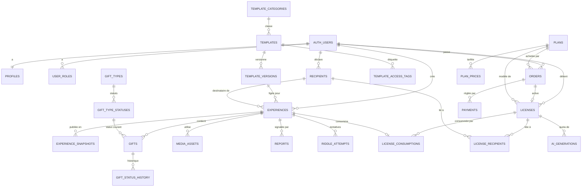

# ZAWELI — Phase 3 : modèle de données

> Statut : **v0.1, à valider**.
> Date : 6 novembre 2026.
> Entrées : [cahier des charges v0.2](02-cahier-des-charges.md) et [architecture v0.1](03-architecture-technique.md) (A1 à A16 validés).
>
> Livrables :
> - ce document ;
> - `supabase/migrations/` : 10 migrations SQL ordonnées. Les données de référence (types de cadeaux, catégories, paramètres) sont dans la migration `1000_reference_data`, car `supabase db push` n'exécute jamais les seeds : correction faite en phase 5 ;
> - `supabase/seed/00_local_dev.sql` : développement local uniquement (utilisateur de connexion de l'API) ;
> - `supabase/tests/migrations.pglite.mjs` : 67 vérifications automatisées (§10).

---

## 1. Principes

| # | Principe | Traduction dans le schéma |
| --- | --- | --- |
| D1 | Schéma privé | Toutes les tables métier sont dans le schéma **`app`**, que l'API REST automatique de Supabase n'expose pas. Seule l'API NestJS y accède (rôle `zaweli_api`). |
| D2 | Défense en profondeur | La RLS est activée sur **les 29 tables**. Aucune politique n'existe pour `anon` ni `authenticated`, et leurs privilèges sont retirés. |
| D3 | Les règles critiques sont aussi garanties par la base | Licences, statuts de paiement, cadeaux d'argent, immutabilité : l'API vérifie, **et la base refuse** si l'API se trompe (§5) |
| D4 | Données, pas de code | Les manifestes sont du JSON, et les renderers sont référencés par une clé (`coffret@1.0.0`) |
| D5 | Figé une fois publié | Une version de template, un instantané publié ou une ligne d'audit ne se modifient pas |
| D6 | Paramétrable | Aucun prix, durée ni quota n'est écrit en dur. Une licence **copie** les règles de sa formule à sa création. |
| D7 | Identifiants | `uuid` (`gen_random_uuid()`) partout. Les journaux à fort volume utilisent un `bigint` auto-incrémenté. |
| D8 | Montants | `numeric(18,2)` et devise ISO 4217 sur 3 lettres. **Jamais de `float`.** |

---

## 2. Vue d'ensemble



Tables indépendantes : `app_settings`, `audit_log`, `webhook_events` et `music_tracks`.

---

## 3. Tables par domaine

### 3.1 Fondation (migration 0100)

| Table | Rôle | Points clés |
| --- | --- | --- |
| `app_settings` | Paramètres administrables (clé et valeur JSON) | Ex. `gifts.money_transfers_enabled = false` (C1), `drafts.max_active = 5` (C18, à valider) |
| `audit_log` | Journal d'audit | **Ajout seul** : déclencheurs sur UPDATE, DELETE et TRUNCATE, et privilèges retirés à l'API |

Fonctions utilitaires : `set_updated_at()`, `forbid_mutation()`, `current_actor()`, `current_actor_id()`, `setting_bool()`.

### 3.2 Identité (0200)

| Table | Rôle | Points clés |
| --- | --- | --- |
| `profiles` | Profil applicatif, 1 pour 1 avec `auth.users` | Créé **automatiquement** à l'inscription (déclencheur sur `auth.users`) |
| `user_roles` | Rôles `admin` et `support` | Lus en base par l'API, **jamais** depuis le JWT envoyé par le client |

### 3.3 Catalogue (0300)

| Table | Rôle | Points clés |
| --- | --- | --- |
| `template_categories` | Anniversaire, amour… | Seed de 6 catégories |
| `templates` | Fiche commerciale du template | `audience` (`personal` ou `business`), `current_version_id` (clé étrangère composite : la version appartient au template) |
| `template_versions` | Version figée : `manifest` (JSON), `manifest_hash` (SHA-256), `renderer_key` | **Immuable une fois publiée**. Seul le statut d'affichage évolue (`published` → `hidden` → `retired`). |
| `template_access_tags` | Étiquettes utilisées par les formules (`free-eligible`, `solo`…) | C'est ainsi qu'une formule décide quels templates elle couvre |
| `music_tracks` | Bibliothèque musicale | `license_name` est obligatoire, avec un justificatif de licence |

### 3.4 Expériences (0400)

| Table | Rôle | Points clés |
| --- | --- | --- |
| `recipients` | Fiches destinataires | Coordonnées facultatives (minimisation), téléphone au format E.164 |
| `experiences` | Brouillon ou expérience publiée | `content` (JSON validé par l'API contre le manifeste), `disabled_sections`, `slug` (10 à 32 caractères alphanumériques, attribué à la 1re publication), `access_code_hash`, `available_from` |
| `experience_snapshots` | Instantané publié : `public_payload` et `protected_payload` | **Immuable**. Lié à la version figée de son expérience. |
| `media_assets` | Photos envoyées et leurs variantes | Taille et type déclarés, puis type **détecté** et dimensions après traitement |
| `riddle_attempts` | Tentatives sur les énigmes protégées | Sert à la limitation de débit par expérience, énigme et client (empreinte) |
| `reports` | Signalements | Motifs normalisés, traitement par un administrateur |

**Contraintes notables :**
- `(recipient_id, owner_id)` référence `recipients(id, owner_id)` : **impossible de viser le destinataire d'un autre utilisateur**.
- `(template_version_id, template_id)` référence `template_versions(id, template_id)` : la version appartient bien au template.
- Un instantané référence `(experience_id, template_version_id)` : dès qu'une expérience a été publiée, **sa version ne peut plus changer** (S16).
- `slug` est présent si et seulement si `first_published_at` l'est. Les statuts `published`, `disabled` et `suspended` exigent un lien.

### 3.5 Cadeaux (0500)

| Table | Rôle |
| --- | --- |
| `gift_types` | Types : MONEY, PHYSICAL, INVITATION, VOUCHER, EXPERIENCE. `is_monetary`, `is_enabled`. |
| `gift_type_statuses` | Statuts permis par type : `is_initial`, `is_terminal`, `requires_provider_confirmation` |
| `gift_status_transitions` | Transitions permises **et l'acteur autorisé** (`user`, `admin`, `system`, `provider`) |
| `gifts` | Un cadeau dans un paquet : `data` (champs saisis), `protected_data` (livré au déballage), `amount` et `currency` |
| `gift_status_history` | Historique automatique de chaque changement de statut, en ajout seul |

**Extensibilité** : un nouveau type de cadeau s'ajoute avec quelques lignes dans les trois tables de référence. **Aucune migration de schéma n'est nécessaire.** Son formulaire et son rendu vivent dans le code (architecture §5.6).

### 3.6 Commerce et licences (0600)

| Table | Rôle | Points clés |
| --- | --- | --- |
| `plans` | Formules (FREE, SOLO, MULTI_USE, ANNUAL…) | Toutes les règles sont des colonnes paramétrables : durée, politique de démarrage, publications, destinataires, quota IA, accès aux templates (`all` ou `tagged`), politique de modification, plafond quotidien. **Une seule formule gratuite.** |
| `plan_prices` | Prix par formule et par devise, avec période de validité | Un seul prix « ouvert » par formule et par devise. L'historique est conservé. |
| `orders` | Commande | Montant et devise **recopiés depuis `plan_prices` par le serveur**. Unicité `(user_id, idempotency_key)`. `paid_at` obligatoire si payée. |
| `payments` | Tentatives de paiement chez le prestataire | Unicité `(provider, provider_payment_ref)` |
| `webhook_events` | Événements reçus, valides ou non | **Unicité limitée aux signatures valides** : un faux webhook envoyé en premier ne peut pas bloquer le vrai |
| `licenses` | Droit concret d'un utilisateur | **Copie des règles de la formule** (`publications_max`, `recipients_max`…) et compteurs. Une seule licence `free` par utilisateur. |
| `license_recipients` | Destinataires liés (MULTI-USE) | Liaison définitive à la première publication |
| `license_consumptions` | Une ligne par création consommée | `experience_id` est **unique** : une expérience ne consomme jamais deux fois |
| `ai_generations` | Générations IA | Réservation, puis solde (`succeeded`, `failed`). Coût estimé. |

---

## 4. Fonctions (migration 0700)

Elles sont appelées par l'API **à l'intérieur de ses transactions**. Toutes verrouillent les lignes qu'elles modifient (`FOR UPDATE`).

| Fonction | Rôle | Erreurs métier possibles |
| --- | --- | --- |
| `ensure_free_license(user)` | Crée la licence gratuite si elle n'existe pas. **Idempotente.** | `FREE_PLAN_NOT_CONFIGURED` |
| `activate_purchase_license(order)` | Crée la licence d'une commande payée. **Idempotente** : une commande, une licence. | `ORDER_NOT_FOUND`, `ORDER_KIND_NOT_LICENSE`, `LICENSE_ORDER_NOT_PAID` |
| `consume_publication(user, license, experience)` | Consomme une création (décision C2) : validité, accès au template, quota, plafond quotidien, liaison du destinataire | `LICENSE_NOT_FOUND`, `LICENSE_NOT_ACTIVE`, `LICENSE_NOT_STARTED`, `LICENSE_EXPIRED`, `EXPERIENCE_NOT_FOUND`, `EXPERIENCE_ALREADY_CONSUMED`, `EXPERIENCE_NOT_DRAFT`, `LICENSE_TEMPLATE_NOT_ALLOWED`, `LICENSE_PUBLICATION_LIMIT_REACHED`, `LICENSE_DAILY_LIMIT_REACHED`, `LICENSE_RECIPIENT_LIMIT_REACHED` |
| `reserve_ai_generation(user, license, task)` | Réserve une unité de quota IA | `LICENSE_NOT_FOUND`, `LICENSE_NOT_ACTIVE`, `AI_QUOTA_EXCEEDED` |
| `settle_ai_generation(id, success, …)` | Solde la génération. **Un échec rend l'unité.** Idempotente. | `AI_GENERATION_NOT_FOUND` |
| `expire_licenses()` | Tâche planifiée : passe en `expired` les licences échues | — |

**Convention d'erreur** : `SQLSTATE P0001`, avec un message égal à un **code métier stable**. L'API le traduit en réponse HTTP et le web l'affiche en français.

**Démarrage d'une licence** (`start_policy`) :
- `on_payment_confirmed` : début = `paid_at`. C'est le défaut décidé pour SOLO.
- `on_first_publication` : début et fin sont fixés **par `consume_publication`** à la première publication.
- `immediate` : début = création.

---

## 5. Garanties assurées par la base

Même si l'API contenait un bug, ces règles tiennent :

| Règle | Mécanisme | Scénario |
| --- | --- | --- |
| Une seule licence gratuite par utilisateur | Index unique partiel `licenses(user_id) where source = 'free'` | S1, S2 |
| Une expérience ne consomme qu'une fois | `license_consumptions.experience_id` unique | S3 |
| Publications concurrentes sérialisées | `SELECT … FOR UPDATE` sur la licence et l'expérience | S3 (voir §10.3) |
| Quota de publications non dépassable | Fonction et `check (publications_used <= publications_max)` | S2 |
| Pas de 4ᵉ destinataire en MULTI-USE | Comptage sous verrou dans `consume_publication` | S7 |
| Une commande ne passe « payée » que par le prestataire | Déclencheur : statut `paid` ou `refunded` exige `app.actor = 'provider'` | S4 |
| Pas de licence achetée active sans paiement | Déclencheur `LICENSE_ORDER_NOT_PAID` | S4 |
| Un webhook authentique n'est traité qu'une fois | Index unique partiel sur les événements à signature valide | S5 |
| Modifier une formule ne change pas les licences vendues | Règles copiées dans `licenses` | — |
| Pas de transfert d'argent réel tant que C1 l'interdit | Déclencheur `MONEY_TRANSFERS_DISABLED` | S11 |
| « Transféré » ou « financé » uniquement sur confirmation du prestataire | Transitions par acteur, et `requires_provider_confirmation` | P6 |
| Version de template publiée immuable | Déclencheur `TEMPLATE_VERSION_IMMUTABLE` | S16 |
| Version d'une expérience publiée figée | Clé étrangère composite instantané → expérience | S16 |
| Instantané publié immuable | Déclencheur et privilège UPDATE retiré | — |
| Journal d'audit en ajout seul | Déclencheurs et privilèges retirés | — |
| Destinataire d'un autre utilisateur impossible | Clé étrangère composite `(recipient_id, owner_id)` | — |
| Le navigateur ne lit ni n'écrit rien en base | Schéma non exposé, RLS sans politique, privilèges retirés | — |

### Convention « acteur »

L'API indique **qui agit** au début de chaque transaction :

```sql
begin;
set local app.actor = 'provider';   -- 'user' (par défaut) | 'admin' | 'system' | 'provider'
set local app.actor_id = '…';       -- facultatif
-- … traitement du webhook …
commit;
```

`set local` limite la valeur à la transaction. **Seul le traitement d'un webhook vérifié** (ou le rapprochement auprès du prestataire) positionne `provider`. Par défaut, l'acteur est `user`, le moins privilégié.

---

## 6. Données publiques et protégées

| Donnée | Où | Qui la voit |
| --- | --- | --- |
| Textes, photos, énigmes affectives (réponses hachées), cadeaux sans champs protégés | `experience_snapshots.public_payload` | Le destinataire (page `/g/[slug]`) |
| Codes de bons, réponses des énigmes « de valeur » | `experience_snapshots.protected_payload`, `gifts.protected_data` | **Personne directement.** L'API les livre après vérification (cahier des charges §10.4). |
| Brouillons | `experiences.content` | Le propriétaire, via l'API |

---

## 7. Stockage (migration 0900)

| Bucket | Public | Taille max | Types | Usage |
| --- | --- | --- | --- | --- |
| `uploads` | Non | 25 Mo | JPEG, PNG, WebP, HEIC/HEIF | Fichiers bruts, avant contrôle |
| `media` | Non | 10 Mo | WebP | Variantes des brouillons |
| `published` | **Oui** (chemins UUID) | 10 Mo | WebP | Variantes publiées (architecture A11) |
| `music` | **Oui** | 15 Mo | MP3, AAC, MP4, OGG | Bibliothèque sous licence |

**Aucune politique** n'est créée sur `storage.objects` pour `anon` ni `authenticated` : l'envoi et la lecture privée passent par des **URLs signées émises par l'API**.

Les limites (25 Mo, 10 Mo, 15 Mo) sont des **valeurs techniques de départ** et peuvent être ajustées. Les limites par template restent plus strictes.

---

## 8. Rôles PostgreSQL et connexion de l'API

| Rôle | Type | Usage |
| --- | --- | --- |
| `zaweli_api` | Groupe, **sans connexion** (créé par la migration) | Porte les privilèges et la politique RLS `api_full_access` |
| Utilisateur de connexion de l'API | Créé **hors migration**, avec un mot de passe secret | Membre de `zaweli_api`. Utilisé par NestJS via le pooler. |

À exécuter une fois par environnement, dans la console SQL de Supabase, avec le secret stocké dans l'hébergeur de l'API :

```sql
create role zaweli_api_login login password '<secret fort généré>' in role zaweli_api;
```

Le mot de passe n'apparaît **jamais** dans le dépôt. Le comportement exact du pooler Supabase avec un rôle personnalisé sera **vérifié en phase 5**.

---

## 9. Règles pour les migrations futures

1. Un fichier par changement, nommé `AAAAMMJJHHMMSS_description.sql`, **jamais modifié une fois appliqué** en `staging` ou en production.
2. Toute nouvelle table de `app` active la RLS et crée sa politique `api_full_access`. Le test `every_app_table_has_rls` échoue sinon.
3. Toute nouvelle fonction : `set search_path = ''`, noms qualifiés, et exécution accordée à `zaweli_api` seulement.
4. Pas de donnée commerciale dans les migrations : elle relève de l'administration.
5. Les seeds sont **idempotents** (`on conflict do nothing`). Le test les rejoue deux fois.

---

## 10. Vérification réalisée

### 10.1 Méthode

Docker étant absent (décision A15 en attente), Supabase local n'a pas pu être lancé.
J'ai utilisé **PGlite** : le vrai moteur **PostgreSQL 16.4** compilé en WebAssembly, qui s'exécute dans Node.
Une couche minimale simule ce que Supabase fournit : les rôles `anon`, `authenticated` et `service_role`, une table `auth.users` et une table `storage.buckets`.

Commande (le script sera branché à `pnpm test:db` en phase 5) :

```bash
node supabase/tests/migrations.pglite.mjs
```

### 10.2 Résultat : 67 vérifications réussies, 0 échec

| Domaine | Vérifications |
| --- | --- |
| Migrations | Les 9 s'appliquent dans l'ordre. Le seed est joué deux fois sans erreur. |
| Structure | Les 29 tables ont la RLS. Les 4 buckets sont créés avec la bonne visibilité. |
| Identité | Profil créé automatiquement à l'inscription |
| Catalogue | Version publiée immuable, statut d'affichage modifiable, une seule formule gratuite |
| Expériences | Destinataire d'un autre utilisateur refusé, statut publié sans lien refusé, lien au mauvais format refusé |
| FREE (S1, S2) | 1re publication acceptée, 2e refusée, double consommation refusée, licence d'autrui refusée, 2e licence gratuite impossible |
| Paiement (S4, S5) | Licence inactivable sans paiement, statut « payé » refusé hors prestataire, clé d'idempotence unique, activation idempotente, règles copiées et non affectées par une modification de la formule |
| MULTI-USE (S7, S8) | 3 destinataires acceptés, 4ᵉ refusé, nouvelle expérience pour un destinataire déjà lié acceptée |
| Expiration (S9) | Licence expirée refusée, template hors formule refusé, `expire_licenses()` fonctionnelle |
| Versions (S16) | Version figée après publication, instantané immuable |
| Cadeaux (S11) | Promesse MONEY acceptée, transfert réel bloqué (C1), statut initial et transitions contrôlés, historique tenu, « FUNDED » réservé au prestataire |
| Webhooks | Faux webhook sans effet sur le vrai, doublon authentique refusé |
| IA (S17) | Quota respecté, un échec rend l'unité |
| Sécurité | Audit en ajout seul, `anon` et `authenticated` sans aucun accès, `zaweli_api` limité (pas de modification de l'audit ni des instantanés) |

### 10.3 Ce qui n'a PAS été vérifié

- **La concurrence réelle (S3)** : PGlite n'a qu'une connexion. Le verrouillage repose sur `FOR UPDATE`, un mécanisme standard de PostgreSQL, mais deux publications simultanées seront testées **sur un vrai Postgres** en phase 5.
- **Les spécificités Supabase** : le déclencheur sur le vrai `auth.users`, le vrai schéma `storage`, le rôle de connexion via le pooler, `supabase db reset`. À vérifier en phase 5, avec Docker ou un projet distant.
- Les performances sous volume.

---

## 11. Suppression et conservation des données

| Cas | Comportement |
| --- | --- |
| Suppression d'un compte **sans commande** | Cascade : profil, destinataires, expériences, médias, licences |
| Compte **avec commandes** | Suppression bloquée (`orders.user_id ON DELETE RESTRICT`). Le compte est **anonymisé**, et les pièces comptables sont conservées. Procédure à écrire avec l'API. |
| Expérience supprimée par l'utilisateur | Statut `deleted` (suppression logique), puis tâche de purge des médias (fichiers retirés de `published`) |
| Désactivation ou modération | Statut `disabled` ou `suspended`, et suppression des fichiers publiés (architecture A11) |
| Audit | Conservé. Durée de rétention à décider (**M3**). |

---

## 12. Évolution vers l'espace Business (non créé)

Ajout prévu, **sans casser l'existant** :
- `organizations`, `organization_members` (rôles : propriétaire, éditeur, lecteur) ;
- une colonne `organization_id` **nullable** sur `experiences`, `recipients`, `licenses` et `orders` : `null` signifie compte personnel ;
- `campaigns` (un template et N destinataires, avec des variables par destinataire) ;
- des formules `audience = 'business'`. La colonne existe déjà.

---

## 13. Écarts et choix de cette phase

| # | Sujet | Choix fait | À valider ? |
| --- | --- | --- | --- |
| M1 | Schéma `app` au lieu de `public` | Retenu (défense en profondeur, D1) | Oui |
| M2 | Cadeaux en tables relationnelles (et non dans le JSON du contenu) | Retenu : statuts, historique, futur paiement et tableau de bord `/dashboard/gifts` | Oui |
| M3 | Durée de conservation de l'audit | Non fixée | **Oui** |
| M4 | Statistique d'ouverture (C12) | **Non modélisée** tant que C12 n'est pas tranchée | Selon C12 |
| M5 | Promotions et remboursements détaillés | Hors MVP. L'énumération `license_source` prévoit `promotion`. | Non |
| M6 | Valeurs des formules | **Aucune dans le seed.** Le test utilise des valeurs internes au test. | Toi, via l'administration |
| M7 | Seeds dans `supabase/seed/` | Le fichier `config.toml` de la phase 5 pointera vers ce dossier | Non |

---

## 14. Suite

Après validation : **phase 4, maquettes et design du SaaS**. Je proposerai la structure des écrans avant toute création de page.
En parallèle, **A15** (Docker ou Supabase distant) doit être tranchée avant la phase 5.
