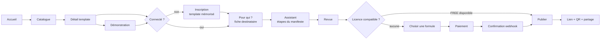

# ZAWELI — Phase 4 : maquettes et design du SaaS

> Statut : **v0.1, structure à valider avant toute création de page**.
> Date : 6 novembre 2026.
> Compléments : wireframes basse fidélité dans [`maquettes/wireframes.html`](maquettes/wireframes.html), à ouvrir dans un navigateur.
>
> Ce document fixe **la structure** : navigation, écrans, contenus, états et règles d'interaction.
> Il ne fixe **pas** l'identité de marque définitive (logo, palette finale) : la direction visuelle du §3 est une proposition (**U1**).

---

## 1. Trois interfaces, trois rôles

| Interface | Pour qui | Ton | Identité |
| --- | --- | --- | --- |
| **SaaS ZAWELI** (site public, tableau de bord, création, administration) | L'expéditeur, l'administrateur | Clair, rassurant, efficace | Design system ZAWELI (`packages/ui`) |
| **Templates** (Coffret…) | Le destinataire | Émotion, mise en scène | Propre à chaque template, jamais modifiable par l'utilisateur |
| **Page du destinataire** (`/g/[slug]`) | Le destinataire | Immersion totale | **Aucun élément du SaaS**, seulement le template. Au plus une mention discrète « Créé avec ZAWELI » en fin d'expérience gratuite (C4, ouvert). |

**Règle de cohabitation** : le SaaS présente les templates comme des **œuvres exposées** (vignettes, démonstrations, aperçu dans une iframe). Il ne les imite pas : le tableau de bord ne prend jamais le velours de Coffret.

---

## 2. Principes d'expérience

| # | Principe | Conséquence concrète |
| --- | --- | --- |
| X1 | **Mobile d'abord**, mais la création est confortable sur ordinateur | Chaque écran est conçu en 390 px puis élargi. L'assistant de création a une mise en page à deux colonnes sur ordinateur. |
| X2 | **Guider, pas éditer** | La création est un assistant à étapes. Pas de canevas, de poignées, de palette de couleurs ni de glisser-déposer. |
| X3 | **Toujours voir le résultat** | Aperçu réel accessible à chaque étape : un panneau latéral sur ordinateur, un bouton « Aperçu » plein écran sur mobile |
| X4 | **Rien n'est perdu** | Enregistrement automatique avec un indicateur discret (« Enregistré il y a 3 s »). On peut quitter et reprendre. |
| X5 | **Payer au bon moment** | On prépare gratuitement. La question de la formule arrive à la publication (décision C2). |
| X6 | **Dire la vérité** | Statuts exacts : « paiement en cours de confirmation », jamais « payé » avant le webhook. Une promesse est présentée comme une promesse. |
| X7 | **Erreurs utiles** | Chaque code métier (`LICENSE_RECIPIENT_LIMIT_REACHED`…) a un message français et **une action proposée** |
| X8 | **Accessible** | WCAG 2.2 AA, cibles tactiles d'au moins 44 px, focus visible, formulaires étiquetés, pas d'information portée par la seule couleur |

---

## 3. Direction visuelle du SaaS (proposition U1)

Objectif : un SaaS moderne et sobre, **cousin** de l'univers Coffret sans le copier.

| Élément | Proposition | Raison |
| --- | --- | --- |
| Fond | Ivoire très clair `#FBF8F3`, surfaces blanches | Chaleureux, laisse briller les vignettes de templates |
| Texte | Encre `#1C1416` et gris chauds | Contraste AA, ton chaleureux |
| Couleur d'action | Bordeaux `#7A0F1E` (boutons principaux, liens actifs) | Continuité avec l'origine de ZAWELI, couleur rare dans les SaaS |
| Accent premium | Or discret `#B8862F`, réservé aux formules payantes et aux badges | Repère « valeur » sans surcharge |
| États | Succès vert `#1F7A4D`, alerte ambre `#9A6400`, erreur `#B42318`, info `#1F5FA8` | Couleurs fonctionnelles standard, toujours accompagnées d'une icône et d'un texte |
| Titres | **Fraunces**, déjà auto-hébergée dans Pauline | Touche éditoriale, cohérence avec Coffret |
| Interface | **Inter** ou **Manrope** (sans-serif) | Lisibilité des formulaires et tableaux |
| Rayons et ombres | Rayon de 12 px pour les cartes, 999 px pour les boutons, ombres très légères | Moderne et doux |
| Icônes | Lucide | Cohérent, libre, déjà utilisé dans le projet Fifi |
| Mode sombre | Plus tard | Hors MVP |

Le logo, la palette finale et le ton de marque sont à valider : **U1**.

---

## 4. Plan du site et navigation

### 4.1 Plan du site

```text
PUBLIC                      AUTH                 TABLEAU DE BORD             ADMIN
/                           /login               /dashboard                  /admin
/templates                  /signup              /dashboard/experiences      /admin/templates
/templates?category=…       /forgot-password     /dashboard/drafts           /admin/plans
/templates/[slug]           /reset-password      /dashboard/recipients       /admin/users
/templates/[slug]/demo      /verify              /dashboard/gifts            /admin/licenses
/pricing                                         /dashboard/licenses         /admin/payments
/how-it-works                                    /dashboard/purchases        /admin/reports
/faq  /contact                                   /dashboard/ai               /admin/stats
/legal/terms                                     /dashboard/settings         /admin/settings
/legal/privacy
                            CRÉATION                         EXPÉRIENCE
                            /create/[template]               /g/[slug]
                            /create/[template]/[draft]/[step]
                            /create/[template]/[draft]/review
                            /checkout/[order]
                            /preview/[draft]  (iframe)
```

### 4.2 Navigation par zone

| Zone | Ordinateur | Mobile |
| --- | --- | --- |
| Public | Barre supérieure : logo, Modèles, Tarifs, Comment ça marche, FAQ, « Se connecter », bouton « Créer une surprise » | Logo, bouton « Créer », menu en tiroir |
| Tableau de bord | **Barre latérale** : Vue d'ensemble, Mes expériences, Brouillons, Destinataires, Cadeaux, Licences, Achats, Assistant IA, Paramètres. Bouton principal « Nouvelle expérience » en haut. | **Barre d'onglets inférieure** : Accueil, Expériences, + (Nouvelle), Licences, Compte. Le reste est dans « Compte ». |
| Création | **Pas de navigation globale.** En-tête minimal : retour, nom du template, indicateur d'enregistrement, Aperçu, Quitter. | Idem, et barre d'action fixe en bas (Précédent / Suivant) |
| Administration | Barre latérale distincte, badge « Admin », couleur neutre (gris ardoise) pour ne jamais confondre avec l'espace client | Utilisable, mais pensée pour l'ordinateur |
| Expérience `/g` | Aucune | Aucune |

---

## 5. Parcours clés

### 5.1 Première création (FREE)



### 5.2 Retour de paiement

| État reçu de l'API | Écran |
| --- | --- |
| `pending` | « Paiement en cours de confirmation… ». Indicateur, interrogation de l'API toutes les 3 s pendant 2 min, puis « Nous vous enverrons un e-mail dès la confirmation ». **Aucune licence annoncée.** |
| `paid`, licence active | « Paiement confirmé ». Résumé de la licence, puis « Publier maintenant » (retour à la revue du brouillon d'origine) |
| `failed` ou `cancelled` | « Le paiement n'a pas abouti ». Le brouillon est intact. « Réessayer » ou « Choisir un autre moyen ». |
| Montant incohérent (alerte serveur) | « Un problème est survenu, notre équipe vérifie. » Référence de commande affichée et contact support. |

---

## 6. Écrans

> Pour chaque écran : objectif, contenu, actions et états. Les wireframes visuels sont dans `maquettes/wireframes.html` (repères **W1 à W12**).

### W1 · Accueil

- **Objectif** : comprendre le concept en 10 secondes, voir une vraie expérience.
- **Contenu** :
  1. Promesse et bouton « Créer une surprise ».
  2. Démonstration animée de Coffret dans un cadre de téléphone.
  3. « Comment ça marche » en 3 étapes : choisir, personnaliser, partager.
  4. Sélection de modèles.
  5. Cas d'usage (anniversaire, amour, félicitations, remerciements).
  6. Le système de cadeaux expliqué (promesse, objet, invitation, bon, expérience).
  7. Tarifs résumés.
  8. FAQ courte et pied de page légal.
- **À éviter** : un carrousel automatique, une vidéo en lecture automatique avec son.

### W2 · Catalogue `/templates`

- Filtres par **catégorie** (puces) et par **formule** (« Gratuit », « Inclus dans MULTI-USE »).
- Cartes : vignette animée au survol (ordinateur) ou image fixe (mobile), nom, catégorie, badges (Gratuit, Nouveau), nombre de photos demandées et types de cadeaux possibles.
- **État vide** : « Aucun modèle dans cette catégorie pour l'instant », avec un lien vers toutes les catégories.

### W3 · Détail d'un template `/templates/[slug]`

- Galerie de captures et bouton « Voir la démonstration » en plein écran.
- **Ce que vous allez personnaliser**, lu depuis le manifeste : liste des étapes, nombre de photos (« 6 photos, format portrait »), énigmes (« 1 à 3 »), cadeaux (« 1 à 3, 5 types possibles »), sections facultatives et musique.
- **Formules compatibles** : badges, avec un lien vers les tarifs.
- Bouton principal « Créer avec ce modèle ».

### W4 · Démarrage de la création `/create/[template]`

- Étape 0 : **Pour qui ?** On choisit une fiche destinataire existante ou on en crée une (prénom obligatoire, note facultative).
- Si une licence MULTI-USE est active, un encart indique : « Cette licence couvre 3 destinataires : Pauline, Marc (2 places restantes). Lier un nouveau destinataire utilise une place à la publication. »
- Le brouillon est créé, puis l'utilisateur est redirigé vers la première étape.

### W5 · Assistant de création `/create/[template]/[draft]/[step]` ★ écran central

**Ordinateur (au moins 1024 px)** : deux colonnes.

| Colonne gauche (45 %) | Colonne droite (55 %) |
| --- | --- |
| Stepper vertical des étapes du manifeste, avec un état par étape (à faire, en cours, complète ✓, incomplète ⚠) | **Aperçu réel** dans une iframe en cadre de téléphone, bascule mobile / ordinateur, et « Aller à cette scène » |
| Formulaire de l'étape : champs générés depuis le manifeste | |
| Barre d'actions : Précédent, Suivant, et indicateur « Enregistré » | |

**Mobile** : une seule colonne. Stepper compact en haut (« Étape 3 sur 7 · Énigmes »), formulaire, barre fixe en bas (Précédent, Aperçu, Suivant). L'aperçu s'ouvre en plein écran avec un bouton de fermeture.

**Composants de champ** (générés par le DSL, architecture §5.3) :

| Champ du manifeste | Composant |
| --- | --- |
| `shortText`, `longText` | Champ texte avec compteur (« 42/80 ») et bouton **« ✨ Suggérer »** si `aiAssist` |
| `photo`, `photoGroup` | Zone d'envoi (glisser ou toucher), progression, recadrage guidé au ratio imposé, alternative textuelle **obligatoire** (pré-remplie et modifiable), compteur global (« 4/6 photos ») |
| `riddleList` | Cartes d'énigmes : question, 3 choix avec un bouton radio « bonne réponse », indice, photo et message révélés. Ajout et retrait dans les bornes (« 2/3 énigmes »). |
| `giftList` | Voir W6 |
| `wordList` | Puces éditables (« 8 vœux exactement »), avec des suggestions |
| `music` | Onglets « Bibliothèque ZAWELI » (liste par ambiance, écoute d'un extrait) et « Spotify » (coller un lien, validé, aperçu du lecteur officiel), plus « Sans musique » |
| `select`, `toggle` | Options prévues par le designer uniquement |
| Section facultative | Interrupteur « Inclure l'écrin », avec une phrase expliquant ce que voit le destinataire |

**Panneau IA « Suggérer »** :
1. Choix du ton (tendre, drôle, solennel, professionnel) et de la longueur.
2. Contexte facultatif (« Elle vient de finir ses études »).
3. Bouton « Générer » et le quota affiché (« 3 suggestions restantes »).
4. La proposition s'affiche à côté du texte actuel. Actions : « Utiliser », « Modifier puis utiliser », « Autre proposition », « Annuler ».
5. **Rien n'est remplacé sans clic explicite.**

**États** : chargement du brouillon, erreur d'enregistrement (bandeau « Hors ligne, vos modifications seront enregistrées au retour du réseau »), champ invalide (message sous le champ), quota IA épuisé (bouton grisé avec explication).

### W6 · Étape « Cadeaux »

1. Le template montre ses paquets (« 3 paquets à remplir, au moins 1 »). Chaque paquet est une carte : vide, rempli ou à compléter.
2. **Choix du type** du paquet : 5 grandes tuiles avec une icône et une phrase.
   - Argent (« Je t'offre une somme »)
   - Objet (« Un cadeau que je te remettrai »)
   - Invitation (« Je t'invite… »)
   - Bon (« Un bon pour… »)
   - Expérience (« Un moment à vivre »)
3. **Formulaire propre au type** (cahier des charges §9.3).
4. **Encart de vérité**, toujours visible :
   - Argent : « Ce cadeau est une **promesse** : ZAWELI ne transfère pas d'argent. Le destinataire verra : *Je t'offre 50 USD…* »
   - Objet : « Le destinataire découvrira l'annonce de ton cadeau. Tu pourras indiquer plus tard qu'il a été remis. »
5. **Aperçu de la carte de révélation**, telle que le destinataire la verra après déballage.

### W7 · Revue et publication `/create/[template]/[draft]/review`

- Liste de contrôle générée par l'API : champs obligatoires, photos, cadeaux, énigmes. Chaque point incomplet renvoie à son étape.
- Aperçu final, avec « Revoir toute l'expérience ».
- **Options de lien** : code d'accès facultatif, date de disponibilité.
- **Licence** : les licences compatibles proposées par l'API. Par défaut, celle qui expire en premier. La licence FREE n'est jamais présélectionnée et doit être choisie explicitement (cahier des charges §8.4). Le texte indique ce qui sera consommé : « 1 création · lie Pauline à cette licence ».
- Sans licence compatible : cartes des formules, puis checkout.
- Bouton « Publier », **désactivé pendant l'envoi**, avec une clé d'idempotence.

### W8 · Publication réussie

- « C'est prêt. »
- Lien en grand avec « Copier ».
- **QR code**, téléchargeable en PNG et SVG.
- Boutons de partage natifs (WhatsApp, SMS, autres).
- Conseils : « Ouvre-le toi-même une fois sur ton téléphone », « Le son démarre au premier geste ».
- Liens secondaires : voir l'expérience, retour au tableau de bord.

### W9 · Tableau de bord, vue d'ensemble

- Bandeau des licences actives : formule, jours restants, créations ou destinataires restants, quota IA.
- « Reprendre » : les 3 derniers brouillons, avec leur progression.
- Dernières expériences publiées : statut, date, actions (copier le lien, QR, désactiver).
- **État vide** (nouvel utilisateur) : « Ta première surprise est offerte », puis les modèles gratuits.

### W10 · Mes licences

Une carte par licence :
- formule, statut (active, expirée…), validité (début, fin, ou « démarre à la première publication ») ;
- jauges : créations (`2 / ∞`, `0 / 1`), destinataires liés (avec leurs prénoms), quota IA ;
- droits en clair : « Tu peux créer ✓ · modifier ✓ · publier ✓ · IA ✓ » ;
- pour une licence expirée : « Tes expériences publiées restent accessibles », et « Renouveler ».

### W11 · Achats et checkout

- **Mes achats** : tableau des commandes (date, formule, montant, statut, référence) avec un reçu.
- **Checkout** `/checkout/[order]` : récapitulatif (formule, ce qui est inclus, **prix calculé par le serveur**), choix du moyen proposé par MbiyoPay (mobile money, carte), puis instructions. Le contenu précis dépend de l'API MbiyoPay et sera dessiné quand sa documentation sera disponible (**U2**).

### W12 · Administration (MVP réduit)

| Écran | Contenu |
| --- | --- |
| Formules `/admin/plans` | Liste et formulaire de paramètres (durée, démarrage, créations, destinataires, quota IA, accès aux templates, politique de modification, plafond quotidien), prix par devise avec historique. **Avertissement** : « Les licences déjà vendues conservent leurs règles. » |
| Templates `/admin/templates` | Statut, catégorie, couverture, étiquettes d'accès, version courante, versions et nombre d'expériences par version. **Aucune édition du design.** |
| Utilisateurs | Recherche, fiche (licences, commandes, expériences), suspension |
| Licences | Recherche, attribution manuelle (motif obligatoire, journalisée), prolongation |
| Paiements | Commandes, paiements, événements webhook (signature valide ou non, statut de traitement), relance du traitement |
| Signalements | File, aperçu de l'expérience, désactivation, résolution |
| Statistiques | Inscriptions, publications, conversion FREE → payant, chiffre d'affaires par formule et par devise |
| Paramètres | `app_settings`, avec description. L'interrupteur des transferts d'argent est verrouillé avec un avertissement (C1). |

---

## 7. Messages d'erreur métier

Quelques exemples ; la liste complète sera tenue dans le code (i18n).

| Code | Message | Action proposée |
| --- | --- | --- |
| `LICENSE_PUBLICATION_LIMIT_REACHED` (FREE) | « Ta création gratuite a déjà été utilisée. » | « Voir les formules » |
| `LICENSE_RECIPIENT_LIMIT_REACHED` | « Ta licence MULTI-USE couvre déjà 3 destinataires : Pauline, Marc et Awa. » | « Ajouter un destinataire (extension) », « Choisir un destinataire existant » |
| `LICENSE_EXPIRED` | « Ta licence SOLO a expiré le 12 novembre. Tes expériences restent visibles par leurs destinataires. » | « Renouveler » |
| `LICENSE_TEMPLATE_NOT_ALLOWED` | « Ce modèle n'est pas inclus dans ta formule SOLO. » | « Voir les modèles inclus », « Passer à MULTI-USE » |
| `AI_QUOTA_EXCEEDED` | « Tu as utilisé toutes tes suggestions. Tu peux toujours écrire toi-même. » | « Voir les formules » |
| `MONEY_TRANSFERS_DISABLED` | (ne devrait pas apparaître : l'option n'est pas proposée) | — |

---

## 8. Ton et rédaction

- **Tutoiement** dans le SaaS particulier, cohérent avec l'usage affectif. **Vouvoiement** dans l'espace Business et l'administration (**U3**).
- Des phrases courtes, des verbes d'action sur les boutons (« Publier », pas « Valider »).
- Les mots « transféré », « livré » et « payé » sont **réservés** aux états confirmés (X6).

---

## 9. Composants du design system (`packages/ui`)

| Famille | Composants |
| --- | --- |
| Base | Button (principal, secondaire, discret, danger), IconButton, Link, Badge, Tag, Avatar, Spinner, Skeleton |
| Formulaires | Field (libellé, aide, erreur), TextInput, Textarea avec compteur, Select, RadioCards, Switch, Checkbox, DateInput, TimeInput, PhoneInput, CurrencyAmountInput |
| Médias | Uploader (progression, recadrage), ImageThumb, QrCode |
| Navigation | TopBar, Sidebar, BottomTabs, Stepper (vertical et compact), Breadcrumb, Tabs |
| Retour | Toast, Banner (info, succès, alerte, erreur), Dialog, ConfirmDialog, EmptyState, ErrorState |
| Données | Card, StatCard, Gauge (quota), Table (tri, pagination), Timeline (statuts de commande et de cadeau) |
| Spécifiques | TemplateCard, PlanCard, LicenseCard, GiftTypeTile, GiftRevealPreview, PreviewFrame (iframe et cadre de téléphone), AiSuggestPanel, SaveIndicator |

Base technique proposée : composants **Radix UI** pour l'accessibilité (dialogues, menus, onglets), stylés avec Tailwind. Chaque composant est accompagné de ses états, documentés par des exemples (outil d'exemples à choisir en phase 5 : **U4**).

---

## 10. Points de rupture et responsive

| Largeur | Disposition |
| --- | --- |
| < 640 px | Une colonne, barre d'onglets en bas (tableau de bord), barre d'action fixe (création) |
| 640 à 1023 px | Une colonne plus aérée. L'aperçu de la création reste en plein écran à la demande. |
| ≥ 1024 px | Barre latérale (tableau de bord), deux colonnes (création) |
| ≥ 1440 px | Largeur de contenu plafonnée à 1280 px, l'aperçu garde son cadre de téléphone |

---

## 11. Décisions à prendre (phase 4)

| # | Sujet | Recommandation |
| --- | --- | --- |
| U1 | Direction visuelle du SaaS (§3) : ivoire, bordeaux, or discret, Fraunces et Inter | Valider la direction. Le logo et le ton de marque viendront avec un designer ou ta propre proposition. |
| U2 | Écran de checkout détaillé | Le dessiner après réception de la documentation MbiyoPay |
| U3 | Tutoiement (particuliers) et vouvoiement (Business, admin) | Oui |
| U4 | Outil de documentation des composants (Storybook, Ladle…) | Ladle, plus léger. À confirmer en phase 5. |
| U5 | Ordre des étapes de l'assistant de Coffret | Celui du §5.2 de l'architecture : destinataire, enveloppe, énigmes, cadeaux, vœux, lettre, musique. À ajuster au portage. |

---

## 12. Suite

Après validation de la structure (et de U1) : **phase 5, fondation technique**. Elle livrera le monorepo, Next.js, NestJS, les paquets partagés, la configuration Supabase, le lint, les tests et une application qui démarre réellement.
**Prérequis : décision A15** (Docker Desktop ou projet Supabase distant).
